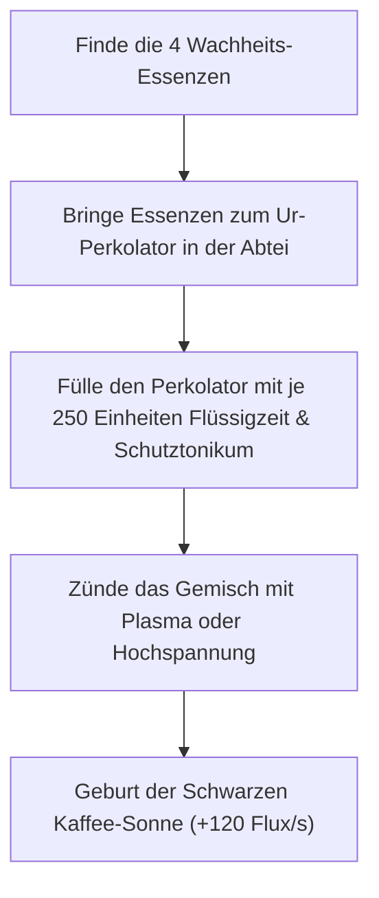

# 05 – Behörden-Großalarm & Endgame-Geheimnisse

Dieses Kapitel beschreibt die erweiterten Endgame-Systeme: Den Behörden-Großalarm bei Stations-Sabotage, die Wackel-Parallelwelten und die kosmische Quest zur Erschaffung der **Schwarzen Kaffee-Sonne**.

---

## 1. Behörden-Großalarm (Stations-Sabotage in der Werkstatt)

Die Werkstatt (`workshop`) ist aus unzerstörbarem `bedrock` gebaut. Sie gilt unter interdimensionalem Arbeitsstättenrecht als neutrale Schutzzone.

### Der Frevel: Stations-Sabotage

Versucht Cloita jedoch, die schützende Neutralität mutwillig zu verletzen:

- Den Händlerplatz (`ws_haendler`) mit Waffen angreifen oder berauben,
- Den Akten-Schredder (`ws_shredder`) mit aktiven Sprengmodulen überlasten,
- Oder den Tresor des Archivschranks (`ws_archiv`) mit dem Bohrkopf aufbrechen:

1. **Der Alarm:**
   - Rote Warnleuchten blinken synchron im Sekundentakt auf.
   - Der schrille Amts-Buzzer ertönt.
   - Bildschirmeinblendung:
     **„VERLETZUNG DER ARBEITSSTÄTTENRICHTLINIE § 4 ABSATZ 2: DIE BEHÖRDE IST ERZÜRNT!“**
2. **Die Vollstreckung (S.O.K.O. Paragraf):**
   - Neben dem Ausgangsportal materialisiert sich sofort der Elite-Ermittler **S.O.K.O. Paragraf** (`soko_paragraf`):
     - **Werte:** 350 LP, reflektierender Paragraphen-Schild (wehrt frontale Schüsse ab).
     - **Angriff:** Verschießt zielsuchende Mahnbescheide, die Cloita für 10 s mit `status_pfaendung` belegen (+40 % Flux-Kosten auf alle Waffen).
     - **Beute:** 200 Gold und ein hochrangiger Dienstausweis.
3. **Der Wiederholungsfall (Chef-Prüfer):**
   - Wird in einem späteren Besuch erneut sabotiert, erscheint der **Chef-Prüfer** (`chef_pruefer`):
     - Besitzt eine temporäre Projektil-Abwehr-Aura; kann im Rücken oder mit Säure verwundet werden.

---

## 2. Wackel-Parallelwelten (Über das Wackelportal)

Gemäß Bibel Kap. 02 werden Parallelwelten über das **Wackelportal (`wobble_portal`)** in der verborgenen Schatzkammer betreten:

- Führt in eine gespiegelte, instabilere Fassung des aktuellen Laufs.
- Kreaturen besitzen höhere Zähigkeit (+50 % LP) und lassen seltenere Proben und Module fallen.
- Bietet zusätzliche Experimentierliegen und Fundkisten für ausgiebige Erkundungsläufe.

---

## 3. Die Kosmische Quest: Die Schwarze Kaffee-Sonne

Cloitas ultimativer Plan, das Schlafbedürfnis abzuschaffen und der Behörde mit endloser Koffein-Energie zu trotzen.

### Die 4 Essenzen der Wachheit

1. **Essenz des Röstens (`essenz_roestung`):** Tief im Biskuit-Kern der Kuchenkruste.
2. **Essenz des Blitzes (`essenz_blitz`):** Beute vom Transformator in der Summenden Spule.
3. **Essenz des Zuckers (`essenz_zucker`):** Bewacht von der Ameisenkönigin im Krümelreich.
4. **Essenz der Ewigen Sekunde (`essenz_zeit`):** Schwingt im Ewigen Pendel in der Uhrwerkwüste.

### Das Ritual am Ur-Perkolator

- Im Glockenturm der *Versunkenen Abtei* steht der **Ur-Perkolator** – eine gigantische gläserne Brüh-Apparatur aus Messing und Bronze.
- Setzt Cloita alle 4 Essenzen ein und leitet je 250 Einheiten `fluessig_zeit` und `schutztonikum` (jeweils passend in einen 300-Zellen-Kolben) hinein, beginnt die Maschine zu dampfen.
- Ein abschließender Stromstoß entfesselt die **Schwarze Kaffee-Sonne** (`kaffee_sonne`):
  - Sie spendet Cloita für den Rest des Laufs gewaltige **+120 Flux/Sekunde**!
  - Schaltet den Eintrag *„Die Kaffeepause der Ewigkeit“* im Archiv frei.
