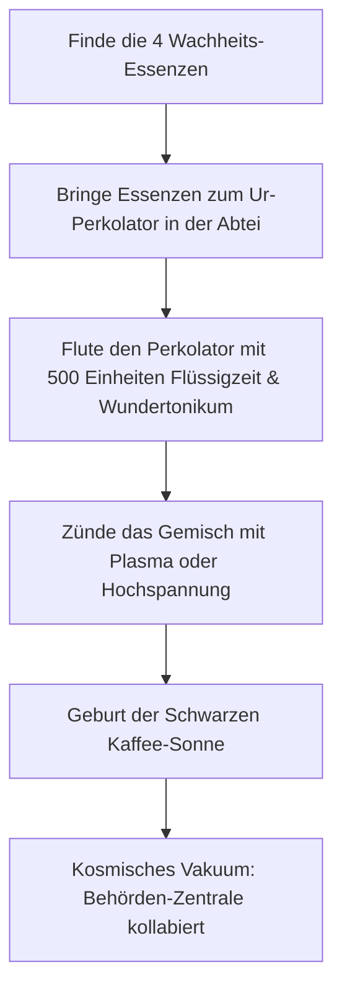

# 05 – Behörden-Großalarm & Endgame-Geheimnisse

Dieses Kapitel beschreibt die ultimativen Endgame-Systeme der Erweiterung (Phasen H–M): Den Behörden-Großalarm bei Beschädigung der Werkstatt (Noitas Stevari-Äquivalent), die unendlichen Wackel-Parallelwelten und die kosmische Quest zur Erschaffung der **Schwarzen Kaffee-Sonne**.

---

## 1. Behörden-Großalarm (Die Werkstatt ist unantastbar)

In der interdimensionalen Werkstatt (`workshop`) herrscht absolute Neutralität – garantiert durch die interdimensionale Arbeitsstättenrichtlinie (Absatz 4, § 2).

### Der Frevel

Versucht Cloita, die verstärkten Schutzwände der Werkstatt mit destruktiven Modulen (z.B. `mod_materie_wandler`, Säure-Geschossen oder Klon-Splitter-Bomben) aufzubohren oder Händler anzugreifen:

1. **Der Alarm:**
   - Rote Warnleuchten blinken synchron im Sekundentakt auf.
   - Ein schriller Amts-Buzzer ertönt.
   - Bildschirmeinblendung (in großen, roten Fraktur-Buchstaben):
     **„VERLETZUNG DER ARBEITSSTÄTTENRICHTLINIE § 4 ABSATZ 2: DIE BEHÖRDE IST ERZÜRNT!“**
2. **Die Vollstreckung (S.O.K.O. Paragraf):**
   - Neben dem Ausgangsportal materialisiert sich sofort der Elite-Ermittler **S.O.K.O. Paragraf** (`soko_paragraf`):
     - **Werte:** 450 LP, reflektierender Paragraphen-Schild (wehrt frontale Geschosse ab).
     - **Angriff:** Verschießt zielsuchende Mahnbescheide, die Cloita für 10 s mit `status_pfaendung` belegen (+50 % Flux-Kosten auf alle Waffen).
     - **Beute:** 250 Gold und ein hochrangiger Dienstausweis.
3. **Der Wiederholungsfall (Chef-Prüfer):**
   - Wird der Tempel/die Werkstatt in einem späteren Universum erneut beschädigt, erscheint der **Chef-Prüfer** (`chef_pruefer`, Noitas *Skoude*):
     - Besitzt eine permanente Projektil-Auflösungs-Aura; kann nur im Rücken oder durch Physik-/Säure-Schaden verwundet werden!

---

## 2. Wackel-Parallelwelten (East & West Worlds)

An den extremen horizontalen Kartengrenzen jedes Universums endet die bekannte Welt nicht an einer harten Wand, sondern an der **Toxischen Bürokratie-Grenze**:

- **Dicke:** Ein 300 Pixel breiter Block aus unzerstörbarem `amts_beton`, durchzogen von radioaktivem `stempel_gift` (verursacht 20 Schaden/s bei Berührung).
- **Der Durchbruch:**
  - Mit extremem Bohrschaden (z.B. Klon-Splitter + Phasenkonverter) oder gezielten Quanten-Teleportern kann Cloita die Barriere durchbrechen.

### Jenseits der Grenze

Dahinter öffnet sich die **Wackel-Parallelwelt** (Ost 1, Ost 2 ... bzw. West 1, West 2 ...):

- **Zustand:** Eine spiegelverkehrte Kopie des aktuellen Universums mit leicht verzerrten Farbpaletten.
- **Kreaturen:** Sämtliche Feinde tragen den Präfix *Parallel-* (z.B. `parallel_aktenfresser`), besitzen dreifache Lebenspunkte und schießen instabile Neon-Kugeln.
- **Vorteil:** Volle neue Werkstätten, frische Experimentierliegen und unberührte Goldadern! Ermöglicht unendliche Perk- und Modul-Kombinationen für epische God-Runs.

---

## 3. Die Kosmische Quest: Die Schwarze Kaffee-Sonne

Das größte optionale Geheimnis des Spiels: Cloitas Plan, den Schlaf ein für alle Mal abzuschaffen und die Behörde durch die Erschaffung einer künstlichen, koffeinhaltigen Mini-Sonne ins Chaos zu stürzen.

### Die 4 Essenzen der Wachheit

1. **Essenz des Espressos (`essenz_espresso`):** Versteckt im tiefen Karamell-Kern der Kuchenkruste.
2. **Essenz des Hochspannungs-Blitzes (`essenz_blitz`):** Droppt beim Sieg über den Transformator in der Summenden Spule.
3. **Essenz des Zuckers (`essenz_zucker`):** Bewacht von der Ameisenkönigin im Krümelreich.
4. **Essenz der Ewigen Sekunde (`essenz_zeit`):** Schwingt im Inneren des Ewigen Pendels in der Uhrwerkwüste.

### Das Ritual am Ur-Perkolator

- Auf dem höchsten Dach des Glockenturms der *Versunkenen Abtei* thront der **Ur-Perkolator** – eine gigantische gläserne Brüh-Apparatur aus Messing und Buntglas.
- Setzt Cloita alle 4 Essenzen in die Sockel ein und leitet 500 Einheiten `fluessig_zeit` sowie 500 Einheiten `wundertonikum` ein, beginnt die Maschine ohrenbetäubend zu gurgeln.
- Ein finaler Stromschlag entfesselt die **Schwarze Kaffee-Sonne** (`kaffee_sonne`):
  - Sie schwebt majestätisch über der Welt, zieht Feinde in ihren Gravitationsstrudel und versorgt Cloita mit permanent unendlichem Flux!
  - **Freischaltung:** Das legendäre wahre Ende *„Die Kaffeepause der Ewigkeit“* im Archiv.
