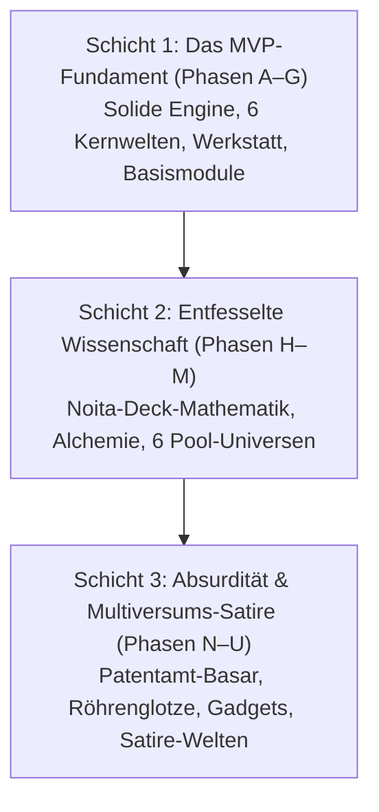

# Phase 3 – Absurdität, Zynismus & Multiversums-Satire: Bibel-Übersicht

Stand: 2026-11-03 (Bereinigt gemäß Statement of Intent). Gilt für den **dritten Ausbau-Lauf (Post-Erweiterung / Phasen N–U)**.
Dieses Dokumentenpaket ist vollständig **vom MVP-Plan (A–G) und vom Phase-2-Plan (H–M) abgekapselt**. Es verleiht dem Spiel den anarchischen, tiefschwarzen Humor, die existenzielle Tiefe und die satirische Absurdität einer hemmungslosen Multiversums-Komödie – **zu 100 % in eigenständiger, originärer Cloita-Lore, ohne Fremd-Serien-Zitate**.

---

## 1. Die drei Schichten des Gesamtwerks

---

## 2. Kapitelübersicht

| Datei | Inhalt | Kernfokus |
| --- | --- | --- |
| `00-uebersicht.md` | Leitidee, Dreischichten-Architektur & Systemregeln | Fundament & Tonalität |
| `01-gadgets-und-apparate.md` | Originäre Notfall-Apparate (Täuschungs-Tauchkapsel, Amts-Imp, Kolben-Libelle, Schaben-Flucht) | Gadget-Slot (Taste G) |
| `02-interdimensionales-fernsehen.md` | Die Interdimensionale Röhrenglotze (`ws_tv`): 12 originäre Sender, Teleshopping & Zuschauer-Buffs | Minispiele & Weltensatire |
| `03-zitadelle-und-klon-legebatterie.md` | Das Interdimensionale Patentamt (`patentamt_hub`), Parallel-Cloitas & das Naivitäts-Alibi | Kosmisches Worldbuilding |
| `04-revoluzzer-klonita-und-quest.md` | Der Rat der bösen Ichs & Die Rebellin Cloita-Null (Bosskampf & Quest) | Kampagnen-Endspiel |
| `05-parasiten-und-zynismus-dialoge.md` | Parasiten-Event „Falsche Freunde“, Zynismus-Datenbank & Werkstatt-Statistikwand | Humor & Narrative |
| `06-absurde-universen.md` | Handgefertigte Satire-Universen Teil 1 (Beamten-Park, Pastell-Hölle, Klonenberg, Talent-Kosmos, Krawatten-Imperium) | Besondere Biome & Ränge |
| `07-satire-universen-teil2.md` | Handgefertigte Satire-Universen Teil 2 (Sanitärium, Simulation, Kollektiv 404, Unsterblichkeits-Resort, Quantenkammer, Kater-Bunker) | Besondere Biome & Ränge |

---

## 3. Grundsätze der Phase-3-Satire

1. **Eigenständige Schöpfungen:** Keine Kopien von Charakteren oder Gags aus Film und Fernsehen. Humor entsteht aus Cloitas unerbittlicher Arroganz, Klonitas bedingungsloser Liebe und dem Wahnsinn interdimensionaler Bürokratie.
2. **Klonita-Schutz:** Klonita ist und bleibt unzerstörbar und einzigartig. Sie stirbt nie und wird niemals nachgezüchtet.
3. **Spielbarkeit vor Gimmicks:** Jedes Universum und jedes Gadget muss den schnellen, präzisen Spielfluss der 2D-Pixel-Engine unterstützen.
