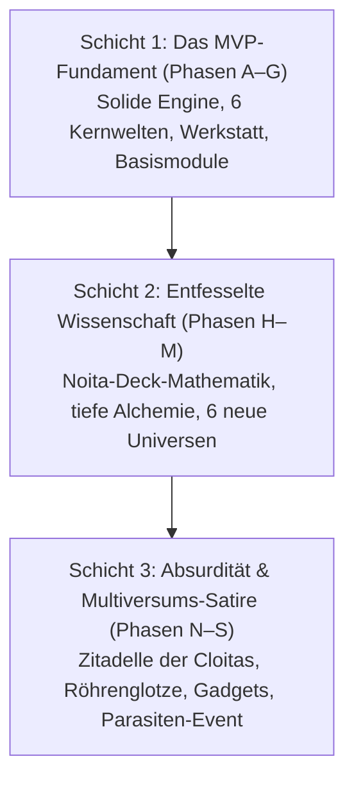

# Phase 3 – Absurdität, Zynismus & Multiversums-Satire: Bibel-Übersicht

Stand: 2026-11-03. Gilt für den **dritten Ausbau-Lauf (Post-Erweiterung / Phasen N–S)**.
Dieses Dokumentenpaket ist vollständig **vom MVP-Plan (A–G) und vom Phase-2-Plan (H–M) abgekapselt**. Es verleiht dem Spiel den beißenden Charme, den zynischen Witz, die existenzielle Tiefe und die satirische Absurdität des Rick & Morty-Multiversums, übersetzt in eigenständige, originäre Cloita-Mechaniken.

---

## 1. Die drei Schichten des Gesamtwerks

---

## 2. Kapitelübersicht

| Datei | Inhalt | Kernfokus |
| --- | --- | --- |
| `00-uebersicht.md` | Leitidee, Dreischichten-Architektur & Referenz-Glossar | Fundament & Tonalität |
| `01-gadgets-und-apparate.md` | Absurde Signature-Gadgets (Gefälschter Säurebottich, Herr Fleißig, Kaffee-Drohne, Gurken-Flucht) | Notfall-Tools & Schabernack |
| `02-interdimensionales-fernsehen.md` | Die Interdimensionale Röhrenglotze (`ws_tv`): 12 Fernsehsender, Teleshopping & Zuschauer-Buffs | Minispiele & Weltensatire |
| `03-zitadelle-und-klon-legebatterie.md` | Die Zitadelle der Cloitas, Naivitäts-Tarnfeld-Lore & die Klon-Legebatterie | Kosmisches Worldbuilding |
| `04-revoluzzer-klonita-und-quest.md` | Der Rat der Chef-Forscherinnen, die Revoluzzer-Klonita & die Revolution | Kampagnen-Endspiel & Bosse |
| `05-parasiten-und-zynismus-dialoge.md` | Parasiten-Event „Falsche Freunde“, Zynismus-Datenbank & Todes-Statistiken | Humor, Dialoge & Narrative |
| `06-absurde-universen.md` | 6 handgefertigte Satire-Universen Teil 1 (Beamten-Park, Pastell-Hölle, Klonenberg, Talent-Kosmos, Spaghetti-Dimension, Krawatten-Imperium) | Besondere Biome & Regeln |
| `07-satire-universen-teil2.md` | 6 handgefertigte Satire-Universen Teil 2 (Heiliges Sanitärium, Simulations-Schachtel, Büro-Kollektiv 404, Unsterblichkeits-Resort, Quanten-Scherbenmeer, Kater-Bunker) | Besondere Biome & Regeln |

---

## 3. Inspirationen: Von Rick & Morty zu Cloita Interdimensional

Um rechtlich absolut eigenständig zu bleiben, werden ikonische Motive der gecrawlten Wiki-Seiten transformiert und satirisch überspitzt:

| Rick & Morty Motiv | Cloita-Äquivalent | Schlüssel | Spielerische / Narrative Funktion |
| --- | --- | --- | --- |
| Citadel of Ricks | **Zitadelle der Cloitas** | `citadel_hub` | Gigantischer interdimensionaler Hub alternativer Cloitas und Klon-Betriebe. |
| Council of Ricks | **Rat der Chef-Forscherinnen** | `council_cloita` | Bürokratisch-elitäres Gremium, das die Zentral-Kurve aller Universen kontrolliert. |
| Evil Morty | **Die Revoluzzer-Klonita** | `revoluzzer_klonita` | Bittere Klonita mit Augenklappe und Aktenkoffer; plant den Sturz aller Cloitas. |
| Morty Cloaking Brainwaves | **Naivitäts-Tarnfeld** | `lore_naivitaet` | Cloitas kriminelles Genie wird vor der Behörde nur durch Klonitas blanke Dummheit getarnt. |
| Interdimensional Cable | **Interdimensionale Röhrenglotze** | `ws_tv` | Interaktiver Röhrenfernseher in der Werkstatt mit 12 improvisierten Sendungen & Cheats. |
| Fake Vat of Acid | **Der Gefälschte Säurebottich** | `gadget_saeurebottich` | Notfall-Tauchkapsel mit Schnorchel & Fake-Knochen zur perfekten Feind-Täuschung. |
| Meeseeks Box | **Büchse des Herrn Fleißig** | `gadget_herr_fleissig` | Spawnt blaue, verzweifelte Hilfsgeister: „Existenz ist bürokratische Folter!“ |
| Butter Robot | **Kaffee-Drohne** | `gadget_kaffee_drohne` | Fragt traurig nach ihrer Bestimmung („Du bringst mir Kolben“ – „Mein Gott...“). |
| Pickle Rick | **Gurken-Notfallmutation** | `mod_gurken_flucht` | Verwandelt Cloita bei Tod in eine rachsüchtige Salzgurke mit Kakerlaken-Beinen. |
| Microverse Battery | **Mikro-Universums-Batterie** | `gadget_mikro_batterie` | Zwingt winzige Zivilisationen zur Flux-Erzeugung unter dem Vorwand von Sportfesten. |
| Memory Parasites | **Gedächtnis-Schmarotzer** | `event_falsche_freunde` | Spawnt zuckersüße Schein-Freunde („Kühlschrank-Klaus“); nur wer beleidigt, ist echt! |
