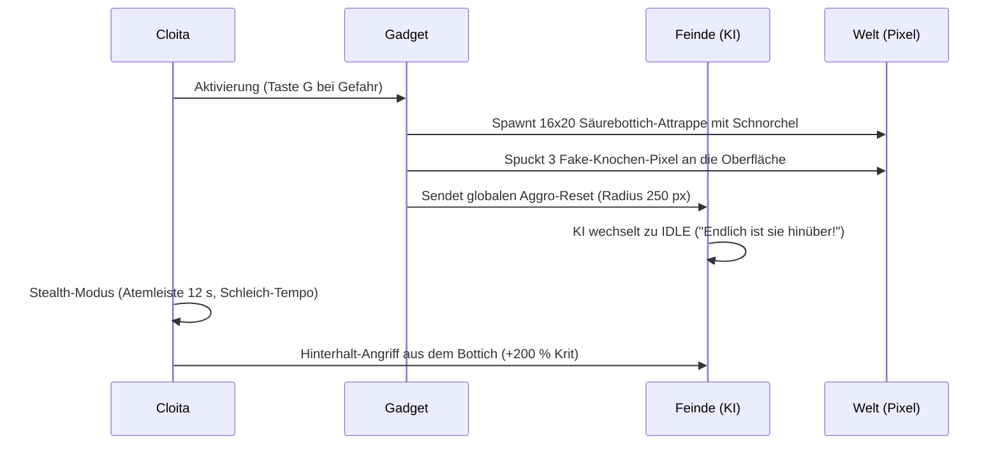

# 01 – Absurde Gadgets & Notfall-Apparate

Dieses Kapitel definiert die fünf ikonischen, satirischen Signature-Gadgets der Phase 3 (Phasen N–S). Sie erweitern Cloitas Notfall-Ausrüstung um unkonventionelle Taktiken, Stealth-Elemente und bitterbösen Humor.

---

## 1. Der Gefälschte Säurebottich (`gadget_saeurebottich`)

Inspiriert von Ricks legendärem Täuschungsmanöver gegen galaktische Gangster.

- **Aussehen:** Ein zittriger Blechbottich mit giftgrüner Flüssigkeit, aus dem ein gebogener Strohhalm ragt.
- **Wirkung:**
  - Cloita taucht vollständig unter und wird unsichtbar/unantastbar für Zielerfassungen.
  - Drei gebleichte Knochen-Pixel treiben mit einem trockenen *„Plopp“* an die Oberfläche.
  - Alle Feinde im Umkreis brechen ihren Angriff ab. KI-Dialogzeilen: „Puh, Schicht zu Ende. Wer holt Kaffee?“ oder „Das war eklig. Weitergehen.“
  - Cloita kann sich getarnt am Boden fortbewegen. Ein Angriff bricht die Tarnung mit einer Schockwelle.

---

## 2. Die Büchse des Herrn Fleißig (`gadget_herr_fleissig`)

- **Schlüssel:** `gadget_herr_fleissig`
- **Typ:** Wiederverwendbarer Gebrauchsgegenstand (3 Ladungen je Universum, lädt in der Werkstatt nach).
- **Herbeirufung:** Cloita drückt den roten Knopf. Ein blendend blaues Licht zuckt auf, und ein spindeldürrer, leuchtend blauer Hilfsgeist materialisiert sich mit hoher Fistelstimme:
  > **„ICH BIN HERR FLEISSIG! SEHT MICH AN! WAS KANN ICH FÜR SIE TUN?!“**
- **Verhalten:**
  - Sucht sich automatisch die dringlichste Aufgabe im Raum:
    1. Sammelt verstreutes Gold und Proben ein und wirft sie Cloita zu.
    2. Stellt sich heldenhaft in feindliche Geschossbahnen als Schutzschild (hat 60 LP).
    3. Betätigt Schalter, zieht Hebel oder räumt Geröll beiseite.
  - **Erfolg:** Sobald die Aufgabe erledigt ist, ruft er voller Euphorie: *„JUHU! MEINE BESTIMMUNG IST ERFÜLLT! ICH DARF STERBEN!“* und verpufft in einer glücklichen Glitzerwolke.
  - **Eskalation:** Bleibt Herr Fleißig länger als 25 Sekunden im Kampf ohne klare Lösung am Leben, verfällt er in existentielle Panik: *„EXISTENZ IST BÜROKRATISCHE QUAL! WARUM BIN ICH HIER?!“*, drückt seine eigene Büchse und spawnt zwei weitere, noch hysterischere Herren Fleißig!

---

## 3. Die Kaffee-Drohne (`gadget_kaffee_drohne`)

- **Schlüssel:** `gadget_kaffee_drohne`
- **Typ:** Passiver Labor-Begleiter (Gegenstand im Rucksack oder Begleiter-Slot).
- **Aussehen:** Eine rostige, zylindrische Kleinst-Drohne mit zwei wackeligen Klemmenarmen und einer rot glimmenden Fotodiode.
- **Lore & Dialog-Interaktion:**
  - Drohne: *„Was ist meine Bestimmung?“*
  - Cloita: *„Du trägst meinen Kolben und reichst mir Kaffee.“*
  - Drohne senkt die Arme: *„Mein Gott...“*
- **Mechanik:**
  - Schaltet einen fliegenden Kolben-Lagerplatz frei.
  - Fliegt bei Klick auf eine Flüssigkeitsquelle selbstständig hin, füllt den Kolben auf und kehrt zitternd zu Cloita zurück.
  - Verleiht Cloita passiv +15 % Bewegungsgeschwindigkeit, solange koffeinhaltige Flüssigkeit im Tank ist.

---

## 4. Die Gurken-Notfallmutation (`mod_gurken_flucht`)

- **Schlüssel:** `mod_gurken_flucht`
- **Typ:** Legendäres Selbstexperiment / Modul (Seltenheit 4).
- **Mechanik:**
  - Erleidet Cloita tödlichen Schaden, stirbt sie nicht. Stattdessen ertönt ein nasses Knacken, ihr menschlicher Körper zerfällt in Asche, und sie schlüpft als **Salzgurke** (`salzgurke_cloita`, 8×14 Pixel) hervor!
  - **Eigenschaften der Gurke:**
    - Besitzt 20 LP und winzige Kakerlaken-Beinchen.
    - Kann durch engste 2-Pixel-Röhren und Lüftungsschächte krabbeln, die für Menschen unpassierbar sind.
    - Kann aus Schrottteilen eine Mini-Ratsche bauen, die rostige Schrauben verschießt.
    - Erreicht sie das Ausgangsportal, regeneriert sie in der Werkstatt im Klon-Bottich vollständig zum Menschen zurück.

---

## 5. Die Mikro-Universums-Batterie (`gadget_mikro_batterie`)

- **Schlüssel:** `gadget_mikro_batterie`
- **Typ:** Waffenrahmen-Zusatz oder Rucksack-Relikt.
- **Aussehen:** Ein Einmachglas, in dem eine vollständige Miniatur-Galaxie aus glimmenden Sternenpulvern rotiert.
- **Mechanik:**
  - Erzeugt permanent +60 Flux pro Sekunde für alle ausgerüsteten Waffen.
  - **Der Arbeitsstreik:** Alle 120 Sekunden streiken die Mikro-Bewohner (sie haben herausgefunden, dass ihr ganzes Universum nur eine Batterie für Cloitas Haartrockner und Funkenpistole ist!). Der Flux-Fluss stoppt.
  - **Lösung:** Cloita muss das Glas schütteln (`Taste F`) oder Klonita vors Glas setzen. Klonita hält eine herzzerreißende Rede über Fleiß und verspricht ihnen eine kosmische Sportfeier. Der Streik bricht ab, der Flux fließt wieder.
