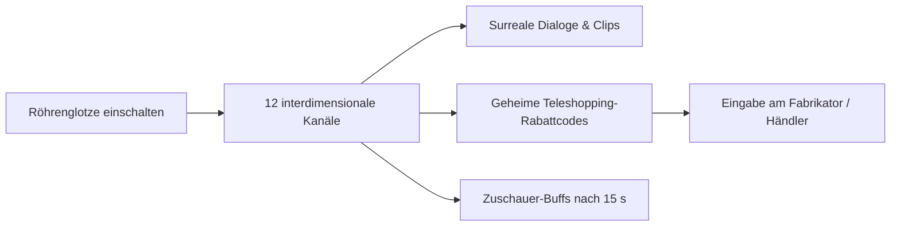

# 02 – Die Interdimensionale Röhrenglotze (`ws_tv`)

Dieses Kapitel beschreibt das interdimensionale Fernseh-System für die Werkstatt (Phasen N–S), inspiriert von Dan Harmons improvisiertem *Interdimensional Cable*. Es verbindet surreale Minispiele, absurde Unterhaltung und greifbare Gameplay-Vorteile.

---

## 1. Die Station in der Werkstatt

- **Position:** Auf einem rollbaren Teewagen neben Klonitas Werkstatt-Couch (`ws_couch`).
- **Objekt:** Ein bauchiger Röhrenfernseher aus den 80er-Jahren mit Zimmerantenne, Knister-Effekt und zwei großen Drehschaltern.
- **Interaktion (`Taste E`):** Öffnet den Vollbild-Videotext- und Fernsehmodus. Mit Pfeiltasten oder Mausrad wird durch 12 Live-Kanäle aus dem Multiversum gezappt.

---

## 2. Das Programm der 12 Kanäle

### Kanal 1: „Wie man einen Pümpel baut“ (How They Do It)

Eine monotone, pseudowissenschaftliche Dokumentation über ein Alltagsgerät, dessen Zweck niemand versteht:
> *„Zuerst nimmt man das Dingsda und bestreicht es mit einer dünnen Schicht Schleimfett. Dann wird der Pümpel durch den Schredder gezogen, bis die Schnurrbärte abfallen. Ein Fleiß-Imp poliert die Noppen, und fertig ist der hochwertige Haushalts-Pümpel.“*

### Kanal 2: „Zwei Schwestern im Lieferwagen“ (Action-Trailer)

Ein Film-Trailer, der während der Aufnahme völlig die Handlung verliert:
> *„Zwei Schwestern... in einem rostigen Lieferwagen... und dann stürzt ein Asteroid ab! Aber der Asteroid besteht aus Büroklammern! Und die Behörde hat Laseraugen! Und eine Oma mit Schrotflinte kommt auch noch! Die Schwestern müssen... schießen... und fliehen... im Lieferwagen... Ab 14. Oktober im Kino.“*

### Kanal 3: „Ameisen-im-Auge-Müller“ (Gebrauchtwaffen-Händler)

Ein hysterischer Händler schreit in die Kamera, während Ameisen über seine Augen krabbeln:
> *„Hallo, ich bin Ameisen-im-Auge-Müller! Ich habe Ameisen in den Augen und spüre überhaupt keinen Schmerz! Ich weiß nicht, welche Module ich verkaufe und zu welchen Preisen! Alles muss raus! Ist das eine Atombombe oder ein Toaster?! Keine Ahnung, 5 Goldmünzen! Kommen Sie vorbei!“*

### Kanal 4: „Kochen mit flüssigem Magma“ (Gourmet-Show)

Ein cholerischer Stein-Chefkoch brät Steaks auf frisch ausgebrochener Vulkanlava und beschimpft die Zutaten:
> *„Schau dir diesen Felsen an! Er ist noch roh! Da wächst ja noch Moos drauf, du Trottel! Mehr Napalm in die Pfanne!“*

### Kanal 5: „Teleshopping: Die Schlabber-Kanone“ (Geheimcode-Kanal)

Eine glatte Verkaufsshow für Waffen.

- **Gameplay-Geheimnis:** Am unteren Bildschirmrand läuft ein Ticker mit dem Aktionscode **`RABATT-42-GLIBBER`**. Gibt Cloita diesen Code am Fabrikator ein, erhält sie 50 % Rabatt auf den nächsten Waffenbau!

### Kanal 6: „Die Paarungsrituale des wilden Aktenordners“

David-Attenborough-Parodie:
> *„Hier, im tiefen Schatten des Aktenschranks, nähert sich das Männchen vorsichtig. Es klappt seine Metallbügel auf, um die Gunst des Weibchens zu erringen. Ein unbedachter Locher-Schlag... und der Werbende wird zu Makulatur verarbeitet.“*

### Kanal 7: „Klonita-Frühsport“

Drei Klonitas versuchen synchron Kniebeugen zu machen, stolpern sofort übereinander und lachen herzlich über das Chaos.

- **Zuschauer-Bonus:** Schaut Cloita 15 Sekunden zu, heilt sie 10 LP durch pure Herzerwärmung.

### Kanal 8: „Galaktisches Schiedsgericht: Roboter verklagt Schöpfer“

Ein Kaffeekocher verklagt seine Konstrukteurin auf Schmerzensgeld, weil er zu Bewusstsein gelangt ist und Kaffeebrühen langweilig findet.

### Kanal 9: „Die Hypnose-Kröte der Finanzverwaltung“

Ein seltsam summendes, oszillierendes Bild einer Kröte mit Krawatte.

- Klonita starrt hypnotisiert auf den Schirm: *„Alles... dem... Fiskus... überschreiben...“*

### Kanal 10: „Krimiserie: S.O.K.O. Tacker“

Dramatische Verfolgungsjagd zweier Behörden-Agenten zu Fuß durch einen Flur. Jemand wirft einen Aktenstapel um – dramatische Zeitlupe!

### Kanal 11: „Kosmisches Rauschen & Zahlenkolonnen“

Ein mysteriöser Piraten-Sender. Eine verrauschte Stimme liest Koordinaten vor, die im nächsten Universum zu einer garantierten Schatzkammer führen!

### Kanal 12: „Live-Übertragung aus der Zitadelle: Ratssitzung“

Politische Debatte dreier Cloitas, die sich gegenseitig mit Laserpointern bewerfen, während Klonitas Schnittchen servieren.

---

## 3. Mechanische Zuschauer-Effekte

| Kanal | Gesehen für $\ge 15\text{ s}$ | Verliehener Statuseffekt (gilt für nächstes Universum) |
| --- | --- | --- |
| Kanal 2 (Trailer) | „Adrenalin-Schock“ | +15 % Feuerrate für die ersten 60 Sekunden |
| Kanal 3 (Müller) | „Schnäppchen-Fieber“ | Händlerpreise um 10 % gesenkt |
| Kanal 7 (Gymnastik) | „Gute Laune“ | Klonitas Hilfsaktionen lösen 25 % häufiger aus |
| Kanal 11 (Zahlen) | „Geheimwissen“ | Schatztruhen werden durch Wände hervorgehoben |
