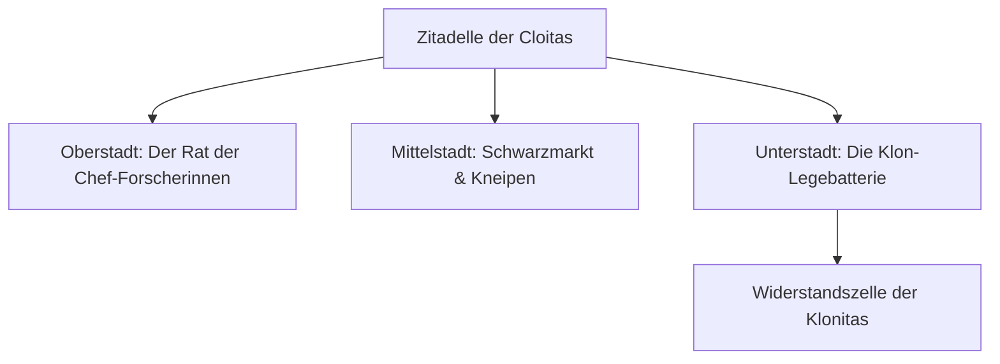

# 03 – Die Zitadelle der Cloitas & die Klon-Legebatterie

Dieses Kapitel beschreibt das Herzstück des erweiterten Worldbuildings (Phasen N–S): Die **Zitadelle der Cloitas** als begehbaren interdimensionalen Mega-Knotenpunkt und die finstere, satirische Wahrheit hinter Klonitas wahrer Bestimmung.

---

## 1. Die Zitadelle (`citadel_hub`)

Die Zitadelle ist eine gewaltige Raumstation in Form eines gigantischen Reagenzglases, verankert im Niemandsland zwischen den Dimensionen.

- **Zugang:** Ein spezielles Resonanz-Portal, das sich ab NG+ („Noch einmal, nur schlimmer“) oder nach Finden von 3 geheimen Zitadellen-Chips in den Universen öffnet.
- **Bevölkerung:** Tausende alternative Versionen von Cloita aus allen Winkeln des Multiversums:
  - **Cowboy-Cloita:** Schießt mit Revolver-Modulen und spuckt Säure in Spucknäpfe.
  - **Fabrik-Cloita:** Arbeitet am Fließband für Reagenzgläser und flucht über die Gewerkschaft.
  - **Gurken-Cloita:** Weigert sich strikt, sich wieder in einen Menschen zurückzuverwandeln.
  - **Bürokratie-Cloita:** Hat Seiten gewechselt und arbeitet im interdimensionalen Senat.

---

## 2. Die finstere Wahrheit: Das Naivitäts-Tarnfeld

Warum schleppt die brillante Cloita ausgerechnet eine tollpatschige, naive Klonkopie mit sich herum?

### Die wissenschaftliche Erklärung

1. **Das Genie-Signal:** Cloitas Gehirn rotiert auf hyperdimensionalen Frequenzen. Jeder ihrer genialen Einfälle erzeugt elektromagnetische Spitzen, die von den Peilsatelliten der Behörde sofort als *„Nicht genehmigte Grundlagenforschung“* geortet werden.
2. **Die Naivitäts-Strahlung:** Klonitas Gehirnwellen hingegen sind vollkommen glatt, frei von bösartigen Gedanken und erfüllt von kindlicher Begeisterung für Schmetterlinge, Kekse und bunte Farben.
3. **Phasen-Auslöschung (Destruktive Interferenz):**
   $$\text{Signal}_{\text{Cloita}} + \text{Signal}_{\text{Klonita}} = 0$$
   Die beiden Gehirnwellen heben sich auf den behördlichen Radarschirmen gegenseitig auf! Klonita ist kein Haustier – **sie ist Cloitas lebender Tarnschild gegen die interdimensionale Polizei.**

> [!NOTE] Klonitas Schicksal
> Wenn Klonita im Kampf fällt, verdoppelt sich sofort die Spawn-Rate der Behörden-Agenten, bis Cloita in der Werkstatt eine frische Kopie aus dem Bottich zieht!

---

## 3. Die Klon-Legebatterie (`klon_legebatterie`)

Im industriellen Keller der Zitadelle liegt die Fabrikationsanlage:

- **Aussehen:** Endlose Reihen zylindrischer Glastanks, in denen Klonitas herangezüchtet werden. Roboterarme ziehen fertige Klone am Kragen heraus, ziehen ihnen den weißen Kittel an und drücken ihnen einen Kolben in die Hand.
- **Plakate an den Fabrikwänden:**
  - *„Eine Klonita am Tag hält die Behörde auf Distanz!“*
  - *„Klonita beschädigt? Rückgabe nur mit Kassenbon innerhalb von 14 Tagen!“*
  - *„Nicht füttern nach Mitternacht – sie fängt sonst an nachzudenken!“*
- **Klonitas Reaktion beim Besuch:**
  Klonita drückt ihre Nase an ein Glas: *„Guck mal Cloita! Da schwimmt ja noch eine von mir! Dürfen wir sie mitnehmen? Bitte, bitte! Dann können wir zu dritt Seilspringen!“* Cloita schiebt sie eilig weiter: *„Weitergehen, Klonita. Das sind... Zucht-Gurken. Reine Wissenschaft.“*

---

## 4. Viertel der Zitadelle

| Viertel | Funktion | NPCs & Händler |
| --- | --- | --- |
| **Plaza der Forscherinnen** | Prunkvoller Hauptplatz | Snob-Cloita, Klonita-Dressur-Schule |
| **Der Schrott-Basar** | Illegale Module & seltene Rezepte | Schmugzler-Cloita, Ameisen-im-Auge-Müller |
| **Die Fließband-Hallen** | Proben-Verarbeitung & Waffen-Recycling | Gewerkschafts-Cloita |
| **Die Kanalisation** | Versteck der Rebellen | Die Revoluzzer-Klonita (Geheim-Quest) |
