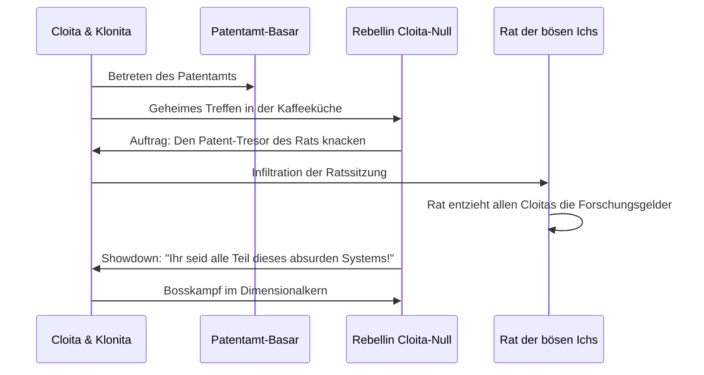

# 04 – Die Rebellin Cloita-Null & der Rat der bösen Ichs

Dieses Kapitel beschreibt den narrativen Höhepunkt der Phase 3 (Phasen N–U): Die Rebellion gegen die bürokratische Ordnung und den Bosskampf gegen **Die Rebellin Cloita-Null (`cloita_rebellin`)**.

---

## 1. Die Figur: Cloita-Null (`cloita_rebellin`)

- **Hintergrund:** Sie ist ein abtrünniges Böses Ich – die allererste Cloita, die einst versuchte, die Behörde von innen heraus zu sprengen. Verraten vom Rat der bösen Ichs, schwor sie Rache an allen bürokratischen Institutionen und Schöpferinnen des Multiversums.
- **Erscheinung:**
  - Zerrissener, brandfleckiger Laborkittel mit hochgekrempelten Ärmeln.
  - Schweißerbrille auf der Stirn.
  - Führt einen massiven, modifizierten Titan-Aktenkoffer, der als Raketenwerfer und Waffen-Arsenal dient.
  - Bitter, zynisch und hochgefährlich – die düstere Vorschau dessen, was aus unserer Cloita werden könnte, wenn sie ihren Zynismus ungefiltert auslebt.

---

## 2. Die Quest: Schatten über dem Patentamt

---

## 3. Bosskampf: Die Rebellin Cloita-Null

Der Kampf findet im **Dimensionalkern** des Patentamts statt:

### Phase 1: Der Koffer des Zorns

- **Taktik:** Sie öffnet ihren Aktenkoffer und verschießt Salven aus wärmesuchenden Büroklammer-Raketen und gezielten Säuresalven.
- **Klonitas Rolle:** Unsere treue Klonita ruft verzweifelt dazwischen: *„Bitte hört auf zu streiten! Wir können doch zusammen Kaffee trinken!“*

### Phase 2: Der Flux-Dämpfer

- **Taktik:** Cloita-Null aktiviert ein Dämpfungsfeld, das Cloitas Flux-Regeneration halbiert.
- **Gegenmittel:** Cloita muss die vier Kondensatoren an den Ecken der Arena zerstören, um ihr volles Waffenpotenzial wieder freizusetzen.

### Phase 3: Der Portal-Riss

- **Taktik:** Bei 25 % Restleben feuert sie einen Dimensions-Bohrer in den Boden. Partikel und Trümmer werden in einen wirbelnden Riss gesaugt.
- **Sieg:** Mit dem letzten Treffer stürzt sie nicht in den Abgrund, sondern wirft ihren Titan-Koffer zu Cloita: *„Nimm ihn. Du wirst ihn gegen den Hohen Rat noch brauchen…“* und springt durch das Tor in die Freiheit.

---

## 4. Belohnung

- **Beute:** Der **Titan-Koffer** (`waffe_titan_koffer`) – fasst 14 Module, besitzt extrem kurze Ladeverzögerung und gewährt +20 % Projektilgeschwindigkeit.
- **Freischaltung:** Der Schwarzmarkt im Patentamt bietet dauerhaft 20 % Rabatt auf alle Module.
