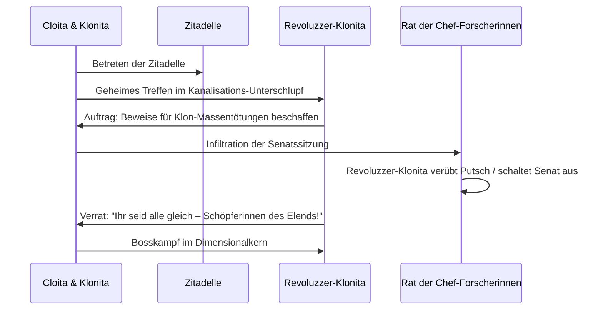

# 04 – Die Revoluzzer-Klonita & der Rat der Chef-Forscherinnen

Dieses Kapitel beschreibt den großen narrativen und spielerischen Höhepunkt der Phase 3 (Phasen N–S): Die Rebellion der Klonitas, den Rat der Chef-Forscherinnen und den epischen Bosskampf gegen die **Revoluzzer-Klonita** (inspiriert von Evil Morty).

---

## 1. Die Figur: Die Revoluzzer-Klonita (`revoluzzer_klonita`)

- **Hintergrund:** Sie ist Klonita Nr. 0001 – der allererste Klon, der von Cloita einst als Testobjekt in einen Säuresee gestoßen wurde. Sie überlebte, trug schwere Brandnarben davon und schwor Rache an allen Cloitas im Multiversum.
- **Erscheinung:**
  - Schmuddeliger Laborkittel mit zerrissenen Ärmeln.
  - Schwarze Augenklappe über dem linken Auge.
  - Trägt einen verstärkten Aktenkoffer aus Titan, der als Waffen-Arsenal und Raketenwerfer dient.
  - Spricht mit eiskalter, ruhiger Stimme – das genaue Gegenteil der fröhlichen Begleiter-Klonita!

---

## 2. Die Questreihe: Schatten über der Zitadelle

### Die 3 Etappen

1. **Flugblätter im Müll:** In den Chunks der Schrotthalde und der Aktenhalde findet Cloita Flugblätter der Untergrundbewegung (*„Brecht die Klon-Ketten!“*).
2. **Die Wahl der Ober-Cloita:** Auf der Zitadelle kandidiert die Revoluzzer-Klonita scheinheilig als „brave Dienerin des Rats“ – und gewinnt durch Wählermanipulation und Erpressung die absolute Mehrheit.
3. **Der Staatsstreich:** Kaum an der Macht, sperrt sie die Dimensionstore, wirft den Rat der Chef-Forscherinnen in die Müllpresse und leitet die Überlastung des zentralen Portalkerns ein, um die künstliche Begrenzung des Multiversums zu sprengen.

---

## 3. Bosskampf: Die Revoluzzer-Klonita

Der Kampf findet im **Dimensions-Reaktor** der Zitadelle statt, umgeben von instabilen Portal-Rissen und herabstürzenden Trümmern.

### Phase 1: Der Koffer des Zorns

- **Taktik:** Sie öffnet ihren Aktenkoffer. Aus dem Koffer schießen gelenkte Mini-Raketen und Salven von Büroklammer-Geschossen.
- **Klon-Mauer:** Sie beschwört 4 getreue Arbeits-Klonitas herbei, die sich schützend vor sie stellen.
- **Klonitas Gewissensbisse:** Unsere Begleiter-Klonita weint im Hintergrund: *„Schwester, bitte hör auf! Wir können doch über alles reden!“*

### Phase 2: Der Naivitäts-Inverter

- **Taktik:** Die Revoluzzer-Klonita aktiviert ein Gerät auf ihrer Brust, das Klonitas Naivitätsstrahlung absorbiert und in konzentrierte Schockwellen aus zynischer Realität umwandelt.
- **Effekt:** Cloitas Bildschirm wird entsättigt; Treffer schwächen Cloitas Flux-Regeneration drastisch.
- **Gegenmittel:** Cloita muss die Energie-Pylonen an den Raumrändern sprengen, um das Feld zu kollabieren.

### Phase 3: Die Entfesselte Flucht

- **Taktik:** Bei 20 % Restleben reißt sie mit einer Portal-Kanone ein klaffendes Loch in das Raum-Zeit-Gefüge. Trümmer, Schreibtische und Portalblöcke werden ins Vakuum gesaugt.
- **Sieg:** Mit dem letzten Treffer stürzt sie nicht in den Tod, sondern springt mit einem bitteren Lächeln durch den Riss: *„Ihr könnt das Multiversum nicht ewig kontrollieren, Cloita. Wir sehen uns jenseits der Kurve.“*

---

## 4. Belohnung & Endspiel-Freischaltung

- **Beute:** Der legendäre **Titan-Koffer** (`waffe_revoluzzer_koffer`) – fasst 16 Module und besitzt 0 Nachladezeit.
- **Freigabe:** Die Klon-Legebatterie wird befreit; Klonitas auf der Zitadelle laufen nun in bunten Kleidern herum, trinken Limonade und schenken Cloita bei jedem Besuch kostenlose Proben!
