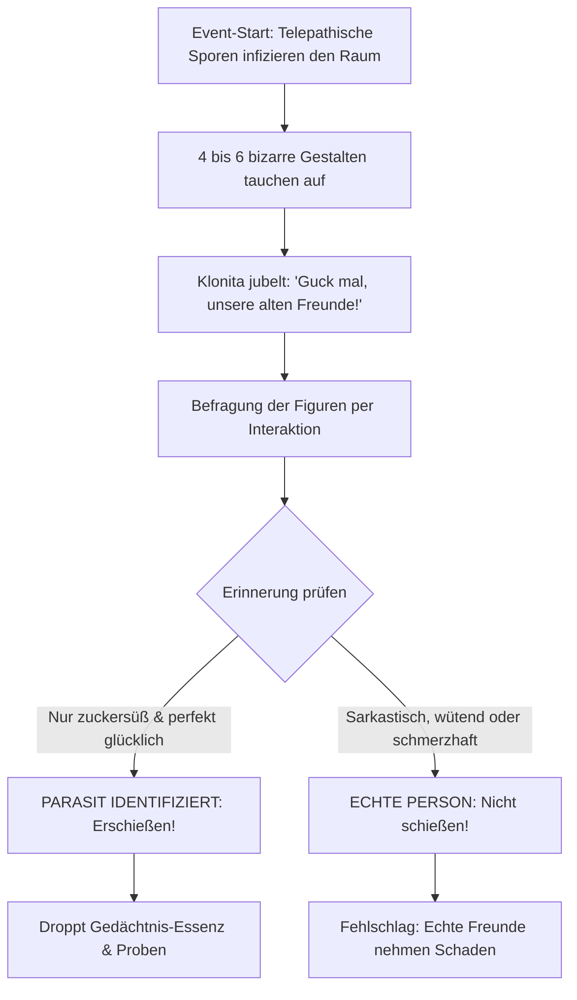

# 05 – Parasiten-Event & Zynismus-Datenbank

Dieses Kapitel spezifiziert das Minispiel-Event **„Falsche Freunde“** (inspiriert von Ricks Gedächtnis-Parasiten in *Total Rickall*) sowie die umfassende Dialog-Datenbank für existenziellen Nihilismus, pechschwarzen Humor und Vierte-Wand-Brüche.

---

## 1. Das Parasiten-Event: „Falsche Freunde“ (`event_falsche_freunde`)

Ein unberechenbares Zufallsevent, das ab Rang 2 in Werkstätten oder verlassenen Aufenthaltsräumen ausbrechen kann.

### Die Verdächtigen

Telepathische Gedächtnis-Parasiten pflanzen Cloita und Klonita falsche Erinnerungen an angebliche gemeinsame Abenteuer ein:

1. **Kühlschrank-Klaus:** Ein laufender Mini-Kühlschrank mit Rollschuhen:
   > *„Cloita! Weißt du noch, wie wir damals auf Malle am Strand lagen und ich dir kühles Radler serviert habe?! Wir waren die besten Freunde!“*
2. **Onkel Büroklammer:** Eine überlebensgroße Büroklammer mit Zylinder und Monokel:
   > *„Aber Cloita, Herzchen! Ich habe dir doch damals bei deiner Habilitation die Akten zusammengeheftet! Ohne mich wärst du nie Wissenschaftlerin geworden!“*
3. **Bleistift-Peter:** Ein schlanker Buntstift mit Ziegenbart:
   > *„Bitte tu mir nicht weh! Weißt du noch, wie wir zusammen Klonitas erstes Bild gemalt haben? Es war wunderschön!“*
4. **Schlafanzug-Schorsch:** Ein gemütlicher Bär im Pyjama, der auf dem Sofa döst:
   > *„Mensch Mädels, kein Stress. Lasst uns einfach Pfannkuchen backen wie früher.“*

### Die eiserne Identifikations-Regel

- **Parasiten können ausschließlich glückliche, harmonische Erinnerungen erzeugen.**
- Die **echte Klonita**, der **Werkstatt-Händler** oder frühere Begleiter haben immer eine Historie von Chaos, Streit, Fast-Toden und bissigen Beleidigungen!
- Wer schlechte Laune hat oder Cloita anbrüllt (*„Wegen dir brennt mein Laden schon wieder, du Irre!“*), ist garantiert echt.

---

## 2. Die Zynismus- und Nihilismus-Datenbank

### Cloitas Leitphilosophie

- **Über das Universum:**
  *„Das Multiversum ist kein magischer Abenteuerspielplatz, Klonita. Es ist eine unendliche Suppe aus radioaktivem Schrott, ätzendem Schleim und chronisch überlasteten Sachbearbeitern.“*
- **Über Fehler:**
  *„Ich habe keinen Fehler gemacht. Ich habe lediglich eine experimentelle Realität erzeugt, in der mein Vorhaben katastrophal detoniert ist.“*
- **Über Klonitas Schmerz:**
  *„Hör auf zu heulen, Klonita. Tränen bestehen zu 98 Prozent aus Salzwasser und zu zwei Prozent aus mangelnder Frustrationstoleranz.“*
- **Über Götter & Religion:**
  *„Wenn es einen Gott in diesem Universum gäbe, hätte er uns bestimmt keine dreifach durchschlagenden Steuerformulare geschickt.“*

### Klonitas naive Gegenwelt

- **Über den Tod:**
  *„Cloita? Wenn ich im Säuresee sterbe... wachse ich dann im nächsten Universum wie ein Pflänzchen nach?“*
- **Über Schläue:**
  *„Ich habe heute versucht, ganz doll wissenschaftlich nachzudenken! Jetzt brummt mein Kopf und mein Kittel hat Feuer gefangen!“*
- **Über Freundschaft:**
  *„Der Zottenwurm da drüben wollte mich bestimmt nur umarmen! Er hat das mit den Zähnen bestimmt nicht so gemeint!“*

### Vierte-Wand-Brüche (Meta-Kommentare)

- **Nach einem Absturz / Tod durch Sturz:**
  *„An die Person mit der Maus in der Hand: Ich spüre jeden einzelnen Pixel-Aufprall. Vielleicht zielst du das nächste Mal mit beiden Augen offen?“*
- **Bei zu langem Stehenbleiben:**
  *„Muss ich hier ewig in der Gegend herumstehen, oder hast du dir gerade einen Kaffee geholt? Ich habe Universen zu sprengen!“*
- **Bei niedrigen Lebenspunkten:**
  *„Ein HP übrig. Perfekt kalkuliert. Oder grob fahrlässig gesteuert – such es dir aus.“*

---

## 3. Die Werkstatt-Statistikwand (`ws_statistik_wand`)

Im Pausenraum neben dem Zapfhahn hängt eine klappernde Fallblatt-Anzeige:

| Zähler | Aktueller Wert | Spruch darunter |
| --- | --- | --- |
| **Cloita-Totalschäden** | 7 | *„Klonen ist billiger als Therapie.“* |
| **Klonita-Verschleiß** | 23 | *„Restbestände bitte im gelben Sack entsorgen.“* |
| **Vom Fiskus gepfändetes Gold** | 45.200 | *„Ihre Steuern arbeiten für den interdimensionalen Straßenbau.“* |
| **Getrunkene Kolben voller Schleim** | 12 | *„Gut für die Magenschleimhaut.“* |
