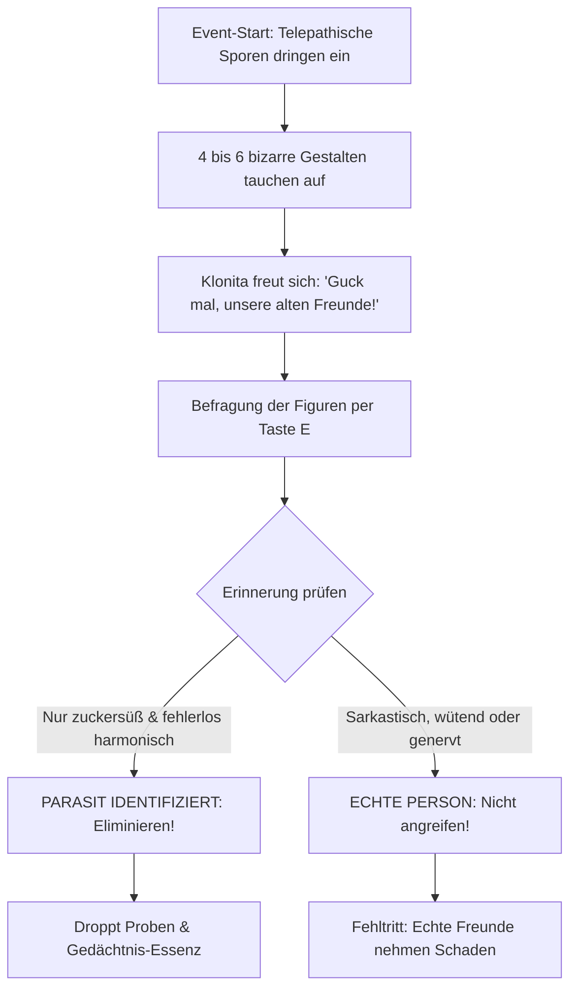

# 05 – Parasiten-Event & Zynismus-Datenbank

Dieses Kapitel spezifiziert das Minispiel-Event **„Falsche Freunde“** (`event_falsche_freunde`) sowie die Dialog-Datenbank für existenziellen Zynismus, trockenen Wissenschafts-Humor und die Werkstatt-Statistikwand.

---

## 1. Das Parasiten-Event: „Falsche Freunde“ (`event_falsche_freunde`)

Ein unberechenbares Zufallsevent, das ab Rang 2 in Werkstätten oder Aufenthaltsräumen ausbrechen kann.

### Die Verdächtigen

Telepathische Gedächtnis-Parasiten pflanzen Cloita falsche Erinnerungen an erfundene Freunde ein:

1. **Thermoskanne Theobald:** Eine laufende Thermoskanne mit Augen und Zylinder:
   > *„Cloita! Weißt du noch, wie wir damals am Strand lagen und ich dir eiskalte Limonade serviert habe?! Wir waren unzertrennlich!“*
2. **Onkel Locher:** Ein lebensgroßer Bürolocher im Frack:
   > *„Aber Cloita, mein Kind! Ich habe dir doch damals bei deiner Doktorarbeit geholfen! Ohne mich hättest du nie promoviert!“*
3. **Bleistift-Peter:** Ein schlanker Bleistift mit Krawatte:
   > *„Bitte tu mir nichts! Weißt du noch, wie wir zusammen Klonitas erstes Bild gemalt haben? Es war wunderschön!“*
4. **Kater-Klaus:** Ein gemütlicher Kater mit Labormantel, der auf der Couch döst:
   > *„Mensch Mädels, kein Stress. Lasst uns einfach Kekse essen wie damals.“*

### Die Identifikations-Regel

- **Parasiten können ausschließlich harmonische, zuckersüße Erinnerungen erzeugen.**
- Die **echte Klonita**, der **Werkstatt-Händler** oder bekannte NPCs haben eine Historie von Missgeschicken, Streit, Explosionen und bissigen Kommentaren.
- Wer schlechte Laune hat oder Cloita anfährt (*„Wegen dir brennt mein Teppich schon wieder, du Chaotin!“*), ist garantiert echt.

---

## 2. Die Zynismus- und Nihilismus-Datenbank

### Cloitas Leitphilosophie

- **Über das Multiversum:**
  *„Das Multiversum ist kein magischer Abenteuerspielplatz, Klonita. Es ist eine unendliche Suppe aus radioaktivem Schrott, ätzendem Schleim und chronisch überlasteten Sachbearbeitern.“*
- **Über Fehler:**
  *„Ich habe keinen Fehler gemacht. Ich habe lediglich eine experimentelle Realität erzeugt, in der mein Vorhaben katastrophal detoniert ist.“*
- **Über Klonitas Optimismus:**
  *„Hör auf zu grinsen, Klonita. Optimismus ist lediglich ein Mangel an quantenphysikalischer Weitsicht.“*
- **Über Vorschriften:**
  *„Sicherheitsrichtlinien sind lediglich die Meinungen von Leuten, deren Experimente nie groß genug waren.“*

### Klonitas naive Gegenwelt

- **Über Gefahren:**
  *„Der Zottenwurm da drüben wollte mich bestimmt nur kitzeln! Er hat das mit den Zähnen bestimmt nicht so gemeint!“*
- **Über Wissenschaft:**
  *„Ich habe heute versucht, ganz doll wissenschaftlich nachzudenken! Jetzt brummt mein Kopf und mein Kittel hat Feuer gefangen!“*
- **Über Cloitas Wutausbrüche:**
  *„Cloita flucht nicht, sie erklärt den Molekülen nur sehr laut ihre Meinung!“*

### Vierte-Wand-Brüche

- **Nach einem Sturz:**
  *„An die Person mit der Maus: Ich spüre jeden einzelnen Pixel-Aufprall. Vielleicht zielst du das nächste Mal mit beiden Augen offen?“*
- **Bei zu langem Stehenbleiben:**
  *„Muss ich hier ewig herumstehen, oder hast du dir gerade einen Kaffee geholt? Ich habe Universen zu sprengen!“*
- **Bei wenig Leben:**
  *„Fünf Lebenspunkte übrig. Perfekt kalkuliert. Oder grob fahrlässig gesteuert – such es dir aus.“*

---

## 3. Die Werkstatt-Statistikwand (`ws_statistik_wand`)

Im Pausenraum neben dem Zapfhahn hängt eine klappernde Fallblatt-Anzeige:

| Zähler | Beispielwert | Spruch darunter |
| --- | --- | --- |
| **Cloita-Totalschäden** | 7 | *„Klonen ist billiger als Therapie.“* |
| **Von Klonita verteilte Umarmungen** | 42 | *„Bisher keine Todesfälle durch Nächstenliebe gemeldet.“* |
| **Vom Fiskus gepfändetes Gold** | 45.200 | *„Ihre Steuern arbeiten für den interdimensionalen Straßenbau.“* |
| **Verschütteter Kaffee** | 18 Liter | *„Verlust im vertretbaren Rahmen.“* |
