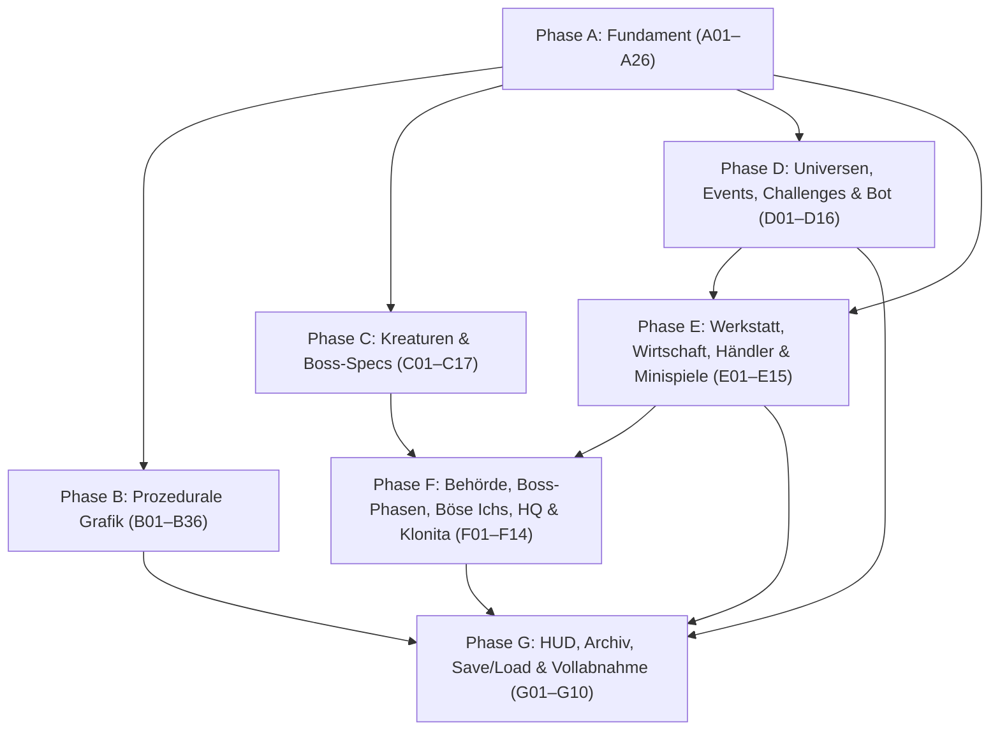

# Atomarer Umsetzungsplan (`py-noita-claude`)

Dieser Ordner enthält den **vollständigen, in 134 reine S-Karten zerlegten Implementierungsplan** für die Fertigstellung von `py-noita-claude` gemäß der Design-Bibel ([docs/bibel/00-uebersicht.md](../bibel/00-uebersicht.md)) und dem [ADR zu atomaren Aufgabenkarten](../adr/2026-11-01-atomare-aufgabenkarten.md).

---

## 1. Grundprinzipien für ausführende Modelle

1. **Nur Größe S & schreibgeschützte Vorab-Tests (`tests/spec/`):** Jede der **134 Karten** (`A01`–`G10`) ist so zugeschnitten, dass ein einzelnes kostengünstiges Modell sie in einem Durchgang fehlerfrei umsetzen kann:
   - **Umfang:** maximal `60–80` geänderte/neue Code-Zeilen pro Karte.
   - **Dateien:** `1–2` Zieldateien ausschließlich unter `src/` oder `tools/`.
   - **Vorab geschriebene Abnahmetests:** Alle Abnahmetests für sämtliche Karten (`A01`–`G10`) existieren bereits vorab unter [`tests/spec/`](../../tests/spec) (`test_phase_a.py` bis `test_phase_g.py`). Ausführende Modelle schreiben **keine** eigenen Tests und dürfen Dateien unter `tests/` **niemals** editieren!
   - **Kontext-Budget:** unter `15 KB` Lese-Kontext (jede Karte verweist gezielt auf die benötigte Teil-Vertragsdatei unter [`docs/plan/vertraege/`](vertraege) und ihre Testfunktion in `tests/spec/`).
   - **Keine offenen Designfragen:** Alle Schlüssel-, Geometrie-, Formel- und Sonderregel-Entscheidungen sind vorab in den Verträgen `V0`–`V23` festgelegt.
2. **Pflicht-Workflow pro Karte:**
   - Lies die im Feld **Zu lesender Kontext** genannten Dateien sowie die zur Karte gehörende Testfunktion `test_<id_klein>_*` in `tests/spec/test_phase_<x>.py` (z. B. `test_a01_` in `tests/spec/test_phase_a.py`).
   - Implementiere exakt die im Feld **Aufgabe** beschriebenen Signaturen und Regeln in den **Ziel-Dateien** unter `src/` bzw. `tools/` (**ignoriere** dort genannte `tests/...`-Pfade als Schreibziel — Tests sind Read-Only!).
   - Führe zur Abnahme den Spec-Test der Karte aus: `uv run pytest tests/spec/test_phase_<x>.py -k <id_klein> -q` (z. B. `uv run pytest tests/spec/test_phase_a.py -k a01 -q`) sowie den Regressionslauf `uv run pytest --ignore=tests/spec -q`.
   - Prüfe den Code-Stil mit `uv run ruff check src tools`.
3. **Tabu-Dateien (`Never`):** `tests/` (inkl. `tests/spec/`), `pyproject.toml`, `CHANGELOG.md` und der Rust-Kern unter `native/` werden **niemals** verändert.

---

## 2. Spezifikation & Schnittstellen-Verträge (`V0`–`V23`)

- **Master-Spezifikation & Vertrags-Index:** [vertraege.md](vertraege.md)
- **8 modulare Vertragsdateien (`< 10 KB` je Datei):**
  1. [v00-migration-und-schluessel.md](vertraege/v00-migration-und-schluessel.md) — `V0a`–`V0d` (Kanonische `probe_*`- & `Region.key`-Namen der 6 MVP-Universen, `Block.rarity_tier`, `World.take_destroyed_cells()`, Vorab-Entscheidungen)
  2. [v01-verhalten-und-wegsuche.md](vertraege/v01-verhalten-und-wegsuche.md) — `V1`–`V4b` (`BehaviourContext`, `Ability`, 20 Fähigkeiten, Haltungen, FSM, A*-Pfadsuche, Fraktionen, Status-Timer & Flaschen-Trinkeffekte)
  3. [v05-sprites-und-teile.md](vertraege/v05-sprites-und-teile.md) — `V5`–`V8b` (`SheetMeta`, `Animator`, `SheetCache`, `ProcRig`/`Chain`/`Legs`/`Tentacle`, Paletten & Sprite-Regeln, Waffenteile)
  4. [v09-universen-und-ereignisse.md](vertraege/v09-universen-und-ereignisse.md) — `V9`, `V10`, `V13`, `V14` (`Level`-Struktur mit `(x0, y0, x1, y1)`-Rechtecken, Generator-Helfer für die 6 MVP-Universen, 6 Hauptevents + Sekundärereignisse, 6 Prüfungen, Playtest-Bot)
  5. [v11-gegenstaende-und-ereignisbus.md](vertraege/v11-gegenstaende-und-ereignisbus.md) — `V11`, `V12` (17 Proben: 12 Universums-Proben + 5 Allgemein-Proben in `src/samples.py`, Inventar-Slots, einheitliches `Pickup`, `Run.emit` & Payload-Tabelle aller 24 Events)
  6. [v15-behoerde-und-bosse.md](vertraege/v15-behoerde-und-bosse.md) — `V15`–`V17` (`Wanted` & 4 Agenten-Spezies, `BossPhase`/`BossScript`, 6 Universums-Zwischengegner `weltenherz`..`abt_kieme`, 3 Böse Ichs + Kaiserin-Handel, Hauptquartier & `"ober_cloita"`)
  7. [v18-werkstatt-und-wirtschaft.md](vertraege/v18-werkstatt-und-wirtschaft.md) — `V18`–`V20` (`640×360`-Werkstatt & 12 Stationen + `STATION_ALIASES`, Preisformeln, 6 Händler `Herr Pansen`..`Bruder Flosse` inkl. Sonderregeln, Fabrikator, 8 Physik-o-Mat-Rätsel + Schießstand)
  8. [v21-klonita-ui-und-speichern.md](vertraege/v21-klonita-ui-und-speichern.md) — `V21`–`V23` (Klonita-Zustandsmaschine, 4 Hilfen & 3 Macken, Sprüche für die 6 MVP-Universen, `SpeechBubble` & Menüs, `Records.discover`, Rang-Formel, Save/Load-Schema & Alias-Tabellen)

---

## 3. Phasen-Übersicht & Karten-Zählung (134 S-Karten)

| Phase | Datei | Karten | Anzahl | Inhalt & Meilenstein |
| --- | --- | --- | --- | --- |
| **Phase A** | [phase-a-fundament.md](phase-a-fundament.md) | `A01`–`A26` | **26 S** | Schlüssel-Migration (`V0a`–`V0d`), 17 Proben & Pickup-Vereinheitlichung, Event-Bus, Status-Timer & Trank-Effekte, A*-Pfadsuche, Fraktionen, Fähigkeiten, Kreaturen-FSM, Sprite-/Rig-/Waffenteil-/Generator-Fundament |
| **Phase B** | [phase-b-grafik.md](phase-b-grafik.md) | `B01`–`B36` | **36 S** | Alle Sprite-Sheets + JSON-Metadaten in kleinen Paketen (`charaktere/`, `kreaturen/` der 6 MVP-Universen + Großkreaturen, `bosse/`, `waffen/`, `zauber/`, `gegenstaende/`, `umgebung/`, `partikel/`) sowie Renderer-Integration in `src/rendering.py` |
| **Phase C** | [phase-c-kreaturen.md](phase-c-kreaturen.md) | `C01`–`C17` | **17 S** | Alle 24 regulären Kreaturen der 6 MVP-Universen + 2 Großkreaturen (`trampolinwal`, `kirchenkrake`), 6 Unter-Zwischenbosse, 6 Haupt-Zwischengegner (`weltenherz`..`abt_kieme`), 4 Behörden-Agenten, 3 Böse Ichs, `"ober_cloita"`, Projektil-Statuseffekte, Drops & Elementar-Resistenzen |
| **Phase D** | [phase-d-universen.md](phase-d-universen.md) | `D01`–`D16` | **16 S** | Alle 6 MVP-Universums-Generatoren (`fleischwelt`, `aktenhalde`, `glibbria`, `kruemelreich`, `sporenklub`, `abtei`) + Pool-Generatoren, `worldgen`-Dispatch, 6 Universums-Events + Sekundärereignisse (`src/events.py`), alle 6 Prüfungen (`src/challenges.py`), deterministischer Playtest-Bot (`src/bot.py`) |
| **Phase E** | [phase-e-werkstatt.md](phase-e-werkstatt.md) | `E01`–`E15` | **15 S** | `640×360`-Werkstatt & 12 Stationen, Wirtschaftsformeln & Goldader-Drops, 6 Händler (`Herr Pansen`..`Bruder Flosse`) mit allen Sonderregeln, Fabrikator, 8 Physik-o-Mat-Rätsel + Schießstand, Werkstatt-Menüs & Trainings-Attrappe |
| **Phase F** | [phase-f-behoerde-bosse-klonita.md](phase-f-behoerde-bosse-klonita.md) | `F01`–`F14` | **14 S** | Fahndungssystem (`Wanted`) & Agenten-Spawns, mehrphasige Boss-Skripte für alle 6 Universums-Zwischengegner, 3 Böse Ichs + Kaiserin-Handel, 3-stufiges Hauptquartier & `"ober_cloita"`, Klonita-Begleiterin & Sprechblasen |
| **Phase G** | [phase-g-abnahme.md](phase-g-abnahme.md) | `G01`–`G10` | **10 S** | HUD-Erweiterung, Sprechblasen- & Boss-Banner-Rendering, Hover-Infos, `Records` & 5-Reiter-Archiv, Endbildschirm mit Rang-Abrechnung, vollständiges Save/Load-Schema, Menü-Tastatursteuerung & Bot-Vollabnahme über alle 6 MVP-Universen |

---

## 4. Abhängigkeits- & Parallelisierungs-Graph

### Empfohlene Abarbeitungsreihenfolge

1. **Sequentieller Start in Phase A (`A01`–`A26`):** Schafft alle Schnittstellen, Datenklassen und Migrations-Anpassungen.
2. **Parallele Stränge nach Phase A:**
   - **Grafik-Strang (`B01`–`B36`)** kann nach `A22`/`A23` komplett unabhängig abgearbeitet werden.
   - **Kreaturen-Strang (`C01`–`C17`)** startet direkt nach `A15`.
   - **Universen-Strang (`D01`–`D16`)** startet direkt nach `A25`.
   - **Werkstatt-Grundlagen (`E01`–`E09`)** starten direkt nach `A04`.
3. **Integration (`E10`–`E15` und `F01`–`F14`):** Verbindet Werkstatt, Händler, Fahndung, mehrphasige Bosse, Böse Ichs, Hauptquartier und Klonita mit `Run`.
4. **Abschluss & Abnahme (`G01`–`G10`):** Vervollständigt UI, Archiv, Save/Load und führt in `G10` die End-to-End-Vollabnahme über alle 9 Universen durch.
